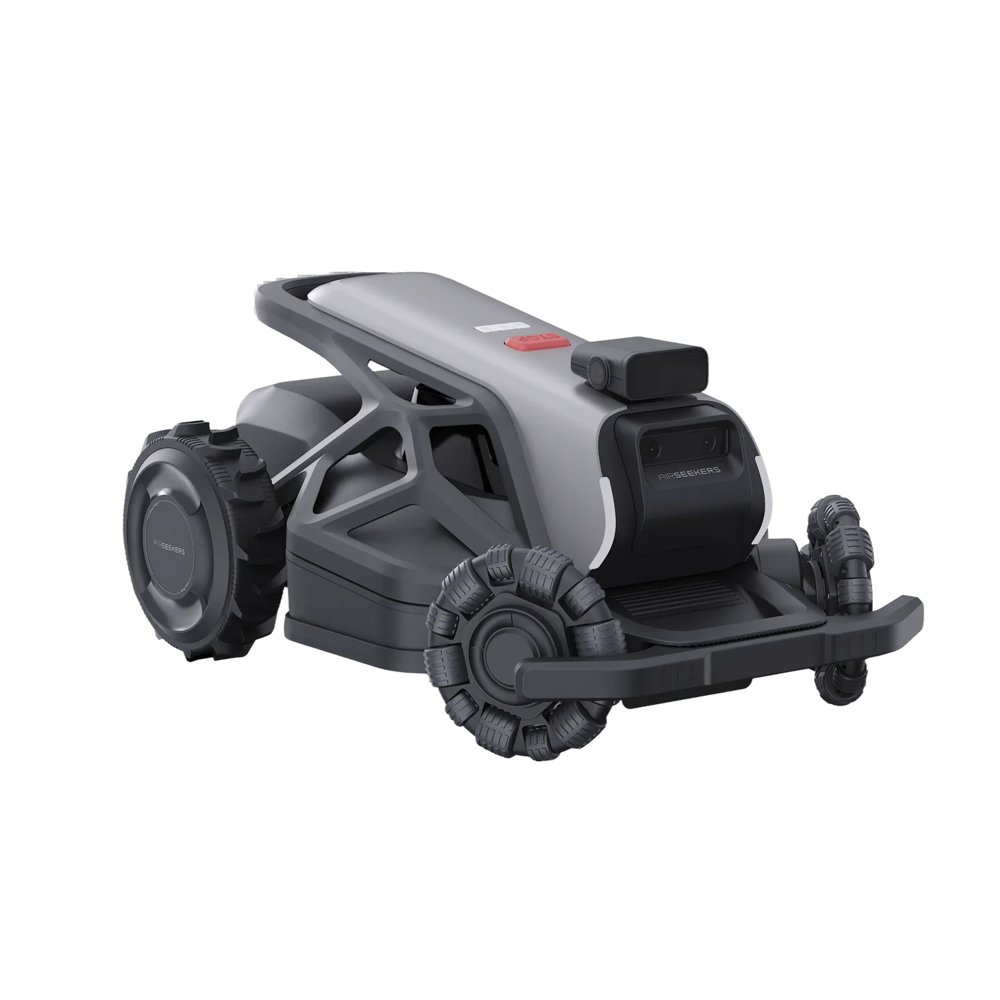

# Airseekers Tron ROS 2

<p align="center">
  
</p>

An open-source, self-hosted software stack for the **Airseekers Tron** robot lawn mower, built on
**ROS 2 Jazzy**. It replaces the vendor's ROS 1 software with a stack you can read, change and run
yourself, and gives you a web app to map your garden and control the mower from a phone or laptop.
No cloud account is needed to run it.

> **Status: experimental.** Docking, undocking and mowing have all been tested, but the stack is
> still young. See [What works today](#what-works-today) before you trust it with a running blade. This project is unofficial and not affiliated with or endorsed by Airseekers.

## What it does

- **Web control app.** Open `http://<mower-ip>:4006` to see the mower live, drive it with an
  on-screen joystick, start, pause and send it home.
- **Draw and edit your garden.** Record a mowing boundary by driving the edge, then add obstacles,
  no-go zones and transit paths; a corridor to the dock is added automatically. The map can be edited from a desktop browser as
  well as a phone, so you can tidy boundaries and zones on a big screen. Import an existing vendor
  map if you have one.
- **Choose how each area is mowed.** See [Mowing patterns](#mowing-patterns) below. Settings are
  per area, and one run can mow several areas.
- **Dock and charge by itself.** Undocks to start a mow, returns to the charging station when
  finished, when the battery is low or when it rains, and resumes where it left off.
- **Centimetre-level positioning.** Fuses RTK GPS, wheel odometry and the IMU. Optional visual
  odometry (OpenVINS, off by default) uses the front stereo camera.
- **Obstacle awareness.** Detects people, pets and objects with the front stereo camera and the
  on-board NPU, then stops or goes around them. Bumper, lift and stop-button handling are built in.
- **Safe by design.** Wheels only move in the states where motion is allowed; a lost connection,
  crashed node or stale command stops the mower; crashes are recorded for diagnosis.
- **Test without a mower.** A headless simulator runs the real navigation, mission and docking
  code, and a sim gate mows a whole map from dock to dock and passes or fails it, so changes are
  checked before they go near a lawn.

## Mowing patterns

Each area has its own settings, chosen in the app:

| Setting | Options |
|---|---|
| **Pattern** | Zigzag (parallel stripes), cross-hatch (stripes in two directions), alternating zigzag (the angle changes each mow), spiral, or contour only (just the edge) |
| **Stripe direction** | Automatic, or a fixed angle. On slopes it can run across the slope, up and down it, or pick automatically by steepness |
| **Stripe order** | Race-track (the default, wide gentle turns that are kind to the lawn), snake, spiral groups, or neighbour-to-neighbour |
| **Edge laps** | 0 to 4 passes round the border, mowed first or last |
| **Turns** | Automatic (forward loop, else reverse-and-curve, else pivot), or force loop, reverse or pivot, with a minimum turn radius |
| **Also per area** | Cutting height (30-90 mm), speed, path width, edge margin, repeats per mow, obstacle sensitivity, and whether to avoid flower beds and gravel |

The planner checks each plan for patches its stripes would miss and adds fill passes for them.
(Tracking what was actually cut during a mow, and revisiting missed patches, is planned.)

## What works today

| Area | State |
|---|---|
| Hardware drivers (MCU, RTK GPS, IMU, cameras) | Running on the mower |
| Web app, map recording and editing (phone and desktop), mission control | Working |
| Mowing: coverage planning, patterns and path following | Complete mows in the field; edges and turns on slopes still being improved |
| Docking and undocking | Tested in the field; the final approach is still being tuned |
| Obstacle detection and stop/avoid policy | Running in the field (grass false stops fixed); avoidance still being tuned |
| Scheduling (web app), rain pause, notifications (Telegram, Pushover, ntfy, webhook) | Built in; not yet tested on the mower |

The current plan and work queue are in [docs/ROADMAP_2026-10.md](docs/ROADMAP_2026-10.md) and
[docs/analysis/2026-10-21_independent_review.md](docs/analysis/2026-10-21_independent_review.md);
field runs are logged in [docs/wheel_smoothness_field_tests.md](docs/wheel_smoothness_field_tests.md).
[docs/STATUS.md](docs/STATUS.md) is the older (2026-10-05) baseline report.

## Getting started

You will need an Airseekers Tron, a computer on the same network, and comfort with SSH and Docker.
**The stack runs in Docker containers on the mower and never reflashes the mower's control
boards.** The host OS stays as shipped, apart from a few host services (udev rules, camera and
power-button units, zram swap) that one script installs and its `uninstall` removes. Always
begin with the wheels off the ground, and never start the blade or drive without being ready to
hit the stop button.

1. **Clone** (the repo uses a submodule):
   ```bash
   git clone --recurse-submodules https://github.com/mikey0000/ros2-airseekers-tron.git
   cd ros2-airseekers-tron
   ```
2. **Prepare the mower once**: install Docker on it and stop the vendor services, as described in
   [docs/deployment.md](docs/deployment.md) ("Mower-side setup").
3. **Build two images on your computer** and copy them to the mower (both are too heavy to build
   there; the arm64 path-planning build needs QEMU, see `scripts/build_f2c.sh`):
   ```bash
   ARCH=arm64 ./scripts/build_f2c.sh      # path-planning library (Fields2Cover)
   ARCH=arm64 ./gui/build.sh              # web app (needs a Mapbox token, see docs/gui.md)
   docker save mower-f2c:v3-arm64 mower-gui:arm64 | gzip | ssh root@<mower-ip> 'gunzip | docker load'
   ```
4. **Provide the AI models.** The vendor's object-detection models can't be redistributed. Copy them
   off your own mower and run `MODELS_SRC=<dir> ./scripts/install_models.sh --runtime`, or run
   without perception (`perception:=false det_range:=false`).
5. **Deploy and start.** The deploy script logs in over SSH (keys, or `SSHPASS` with `sshpass`;
   `MOWER_HOST` and `MOWER_USER` override the defaults):
   ```bash
   export SSHPASS=<password>
   ./scripts/deploy_to_mower.sh all       # sync + image + colcon build, on the mower; starts nothing
   ```
   The first time, install the host services on the mower (udev rules, stereo camera setup,
   power button, zram swap; see [docs/host_zram.md](docs/host_zram.md)), then start the stack:
   ```bash
   sudo /userdata/ros2_stack/scripts/install_host_services.sh   # on the mower, once
   ./scripts/deploy_to_mower.sh up        # start the stack and the web app
   ```
   For later updates note that `sync` only copies files and restarts nothing: a Python-only
   change needs `docker restart mower_jazzy`, anything else `build` and then a restart.
6. **Open the app** at `http://<mower-ip>:4006`, record your boundary, and press start.

Full instructions, including the update loop, the GUI image and starting the stack at boot, are in
[docs/deployment.md](docs/deployment.md). To try things with no hardware at all, see
[docs/simulation.md](docs/simulation.md).

## Using it

1. **Map the garden** from the Map page by driving the outline with the joystick; close the loop to
   create an area. Add obstacles and no-go zones as needed. Once recorded, open the app on a desktop
   browser to refine boundaries, zones and paths on a larger screen.
2. **Set the dock** position so the mower knows where to return.
3. **Pick a pattern** for each area, then **start a mow** from the dashboard, or from the schedule page once scheduling is set up.
4. **Watch and intervene.** Pause, send home, or stop at any time from the app or the mower's
   physical stop button.

More on the app in [docs/gui.md](docs/gui.md); phone Wi-Fi tips in [docs/wifi.md](docs/wifi.md).

## How it works

A short map of the stack; [docs/DEVELOPMENT.md](docs/DEVELOPMENT.md) has the packages and launch
arguments.

- **Hardware.** RK3588 main board (3.9 GB RAM, NPU) running the vendor Ubuntu 20.04; the stack is
  a ROS 2 Jazzy container. Drivers talk to the vendor MCUs over serial, the UM960 RTK receiver,
  the WIT IMU and the cameras (front Metoak XC9080 stereo, decoded as YUYV, plus obstacle and rear
  cameras). Measured from the rear drive axle (`base_link`): body front 0.60 m, rear 0.10 m,
  half-width 0.235 m; wheel track 0.39 m; GNSS antenna 0.098 m forward; cutting deck centre
  0.23 m forward; stock 220 mm blade disc.
- **Velocity chain.** Nav2 controller → velocity smoother → collision monitor → `twist_mux`
  (navigation, docking, teleop, bumper and emergency lanes) → `cmd_vel_slew` → `/cmd_vel` → MCU.
- **Tracking.** MPPI is the single path tracker, for mowing stripes and transits. Transits follow
  the drawn transit paths (route graph) and fall back to Nav2's Smac Hybrid-A* planner.
- **Localisation.** Two EKFs (odom: wheels + IMU; map: adds RTK GPS) and a heading aligner that
  pins the IMU yaw to the RTK course and tracks its drift rate.
- **Coverage.** Fields2Cover plans edge laps and stripes per area; the mission layer runs them as
  blade-on sub-paths joined by blade-off transits, and keeps a resume cursor.
- **Docking.** Reverses onto the charger, guided by the rear camera and an ArUco marker.
- **Web app.** The MowgliNext GUI, vendored in `third_party/mowglinext/`, served on port 4006.
- **Simulator.** `mower_sim` runs the real stack headless; `scripts/sim_gate.sh` does a full
  dock-to-dock mow on a real map and judges it (`-x 3` runs it three times faster than real time).
  See [docs/simulation.md](docs/simulation.md).

## Documentation

| If you want to... | Read |
|---|---|
| Install and update the mower | [docs/deployment.md](docs/deployment.md) |
| Use the web app | [docs/gui.md](docs/gui.md) |
| Understand positioning | [docs/localization.md](docs/localization.md) |
| Pair the RTK base station (no vendor app) | [docs/rtk_pairing.md](docs/rtk_pairing.md) |
| Understand cameras, detection and VIO | [docs/perception_vio.md](docs/perception_vio.md), [docs/cameras_and_video.md](docs/cameras_and_video.md) |
| See how crashes and failures are handled | [docs/crash_recovery.md](docs/crash_recovery.md) |
| Run the simulator and the sim gate | [docs/simulation.md](docs/simulation.md) |
| Hack on the code (architecture, packages, launch arguments, tests) | [docs/DEVELOPMENT.md](docs/DEVELOPMENT.md) |
| See what's planned | [docs/ROADMAP_2026-10.md](docs/ROADMAP_2026-10.md), [work queue](docs/analysis/2026-10-21_independent_review.md) |

## Based on MowgliNext

Parts of this project come from **[MowgliNext](https://github.com/mowglinext/mowglinext)**, an
open-source ROS 2 robot-mower stack. The web app, map server, mission/behaviour layer and several
Nav2 plugins are vendored from it (see `third_party/mowglinext/`), and the overall architecture
follows its design. Thank you to the MowgliNext contributors. We are working to contribute the
Tron support back upstream as a hardware backend; the plan is in
[docs/MOWGLINEXT_INTEGRATION.md](docs/MOWGLINEXT_INTEGRATION.md).

MowgliNext is dual-licensed: GPLv3 for personal and community use, with a separate commercial
licence for commercial use. The vendored parts stay under their upstream terms; check
`third_party/mowglinext/LICENSE` before using this in a product. OpenVINS (`third_party/open_vins`)
is from [rpng/open_vins](https://github.com/rpng/open_vins).

## Safety and disclaimer

A robot mower has a spinning blade. This software is provided as is, without warranty. You are
responsible for testing it safely, keeping people and pets clear, and complying with local rules.
Modifying your mower may void its warranty.

## Contributing

Issues and pull requests are welcome. Start with [docs/DEVELOPMENT.md](docs/DEVELOPMENT.md) for the
build, test and architecture notes.
