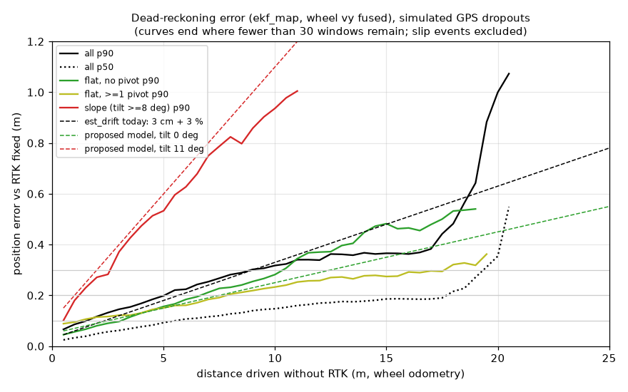
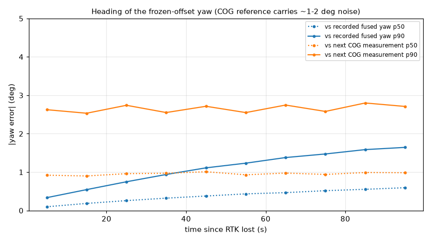
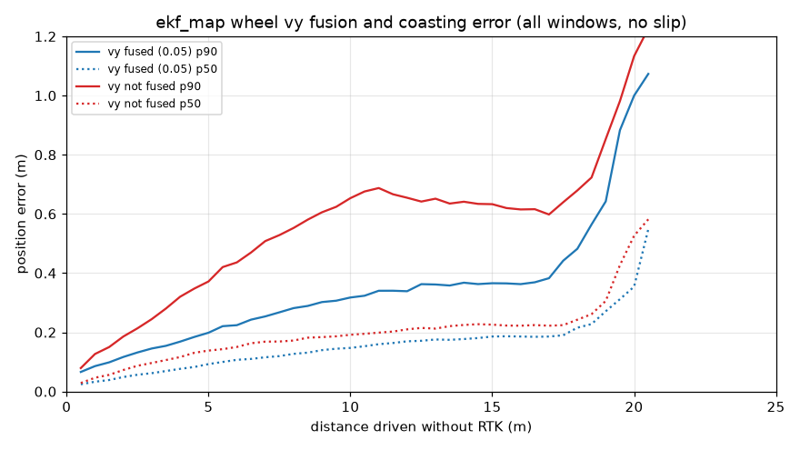

# Dead-reckoning drift without RTK: how far can the mower coast? (2026-11-13)

Branch `ws/drdrift1113` (from `ws/rtkdrop1113`). Offline bag replay only; nothing ran on the
mower. Step 1 towards a "coast through RTK float / dropout" mode like the stock firmware's
(wheel speed + gyro yaw while RTK is not fixed, a 50 m distance budget with pivots free, and a
10 s wheel-only limit).

## Summary

- On flat ground (tilt under 4 deg), with the branch's ekf_map (wheel vy fused), the p90
  position error reaches **0.10 m after 2.5 m, 0.20 m after 7 m and 0.30 m after 14 m** of
  driving without RTK. On the 11 deg Area 4 strip slope it reaches them after **0.5 m, 1.5 m
  and 2.75 m**.
- Pivots in place cost almost nothing: the error vector moves 3 mm (p50) / 9 mm (p90) across a
  pivot, and windows with pivots drift no faster than windows without.
- Heading of the frozen-offset yaw drifts about **0.4 deg/min (p50) and 1.1 deg/min (p90)**. The
  heading error is not what limits coasting on flat ground; the slope is.
- **ekf_map wheel vy matters a lot for coasting.** Without it (master before this branch) the
  same windows reach 0.30 m p90 after 3.75 m instead of 9 m, and a robot standing still drifts
  17 mm (p50) / 48 mm (p90) per minute instead of 1 / 4 mm.
- `est_drift_m` today (3 cm + 3 %/m) is about a p90 bound on flat ground, slightly optimistic
  in the first 2 m (actual error above it in 10-12 % of windows), and far too optimistic on the
  slope (actual above it in 74-89 %). Proposed: **5 cm + 2 %/m on flat ground, rising linearly
  to 10 cm + 10 %/m at 11 deg tilt, + 1 cm per pivot**, plus a wheel-vs-gyro slip trip.
- **Wheel slip is the one failure dead reckoning cannot see.** About 5-10 % of windows had a
  pivot in which the wheels turned 34 deg or more further than the gyro within 2 s. In one of
  them (Area 1, 11 deg slope) the robot slid 1.4 m with the wheel odometry reading zero.
- Proposed coast budget: **5 m on flat ground, 1.5 m at 8 deg or more of tilt** (or driven by
  the proposed model against the edge clearance), a 60 s cap, and stop at once on slip. The
  stock 50 m budget is far beyond what our wheels + gyro hold (p90 0.42 m at 20 m on flat
  ground; no window reached 30 m).
- Real RTK float in these bags was short (mostly under 2 s) and stayed within 0.03-0.2 m of
  dead reckoning. It can serve as a coarse cross-check (gate around 0.3 m), not as truth: the
  float that ended the strip's RTK dropout was about 0.3 m off.

## 1. Method

**Tool.** `scripts/replay/ekf_replay.py` (from the RTK-dropout work) rebuilds `/odom`,
`/imu/data_aligned` and `/odometry/gps` from a field bag and runs robot_localization's
`ekf_map` offline; it reproduced the field pose to 2.0 / 4.7 cm (p50 / p90). New here:

- per variant, `wh_len` / `wh_every` / `wh_phase` withhold the GPS for `wh_len` s in every
  `wh_every` s. During a withheld window the variant's IMU yaw is the yaw heading_aligner would
  publish without RTK: the recorded yaw minus the change of heading_aligner's offset since the
  window start (no COG updates without RTK positions; the tracked offset rate is not applied
  either, because heading_logic only integrates it while RTK positions show motion). The gyro
  yaw itself (stereo IMU, rest-calibrated bias) is unchanged: it does not depend on RTK.
- each variant gets its own IMU and GPS topics; outputs are taken by an executor thread.
- `inputs.csv` also carries `/tilt/status` roll and pitch, `/mcu/measured_speed` and the
  heading_aligner offsets (incl. the raw COG measurements); `--inputs-only` writes only those.

`scripts/replay/drift_analyse.py` turns the runs into the tables and plots below.

**Runs.** Each bag ran once with 12 ekf_map instances: 6 phases (dropouts start every 20 s) x
{wheel vy fused at 0.05 (this branch), vy not fused (before)}. A dropout lasts 100 s, then
20 s of RTK to re-converge. 5x real time, one container per bag.

**Truth.** RTK FIXED `/fix` in the map frame (lever arm and ENU offset fitted as before;
residual 1.3-2.1 cm rms). A dropout counts only if the 10 s before it were all FIXED. Error is
measured at every FIXED fix inside the dropout. Along / cross track are taken against the
recorded heading. Heading truth is either the recorded fused yaw (smooth, but its COG offset
is low-passed, so it lags real drift) or heading_aligner's next raw COG measurement (unbiased,
about 1-2 deg of noise).

**Distance** is the wheel path length since RTK was lost (`|vx|` integrated, as
`localization_monitor` counts it; pivots add nothing). **Pivot**: a turn of 45 deg or more
with `|vx|` under 0.05 m/s. **Tilt**: mean `hypot(roll, pitch)` from `/tilt/status` since the
dropout start. **Slip**: the wheel odometry yaw (`/mcu/measured_speed`) and the fused,
gyro-led yaw rate disagree by 0.6 rad (34 deg) or more within 2 s. Slip windows are reported
separately and left out of the other classes.

**Data.**

| Run | Bag | Bag time | Dropouts | Wheel distance per dropout p50 / max | Mean tilt p50 / p90 |
|---|---|---|---|---|---|
| area3 | 2026-11-11 Area 3 cross-hatch mow | 84 min | 250 | 16.6 / 28.7 m | 3.4 / 8.3 deg |
| area4 | 2026-11-12 Area 4 cross-hatch mow | 168 min | 503 | 17.5 / 27.0 m | 2.5 / 3.7 deg |
| area1 | 2026-11-12 Area 1 (small, on the slope) | 10 min | 28 | 9.7 / 21.8 m | 10.9 / 11.7 deg |
| strip4 | 2026-11-13 Area 4 strip (shuttle passes, real dropout) | 14 min | 33 | 11.7 / 21.8 m | 11.3 / 12.6 deg |

814 dropouts in all, each run with and without vy. Mowing speed with turns and pivots gives
about 17 m per 100 s dropout; 53 dropouts reached 20 m and none reached 30 m.

The "11 deg slope" of Area 1 and the strip is a fall-line slope: pitch is +/-10.7 deg on
headings of about 20 / 200 deg and roll only reaches 10 deg across it. The strip's shuttle
passes run up and down that line. Only 4 dropouts averaged a side-slope roll of 8 deg or more,
so **side slope is not covered by this data**.

## 2. Position error against distance

ekf_map as on this branch (wheel vy fused). Each cell: p50 / p90 / max in metres (number of
dropouts that reached that distance in that class).

| Class | 1 m | 2 m | 5 m | 10 m | 20 m |
|---|---|---|---|---|---|
| all (no slip) | 0.03 / 0.09 / 0.29 (737) | 0.05 / 0.12 / 0.60 (722) | 0.09 / 0.20 / 1.09 (691) | 0.15 / 0.32 / 1.27 (636) | 0.35 / 1.00 / 1.18 (53) |
| straight forward | 0.03 / 0.06 / 0.29 (488) | 0.04 / 0.09 / 0.60 (427) | 0.09 / 0.16 / 0.68 (250) | 0.16 / 0.46 / 0.63 (43) | - |
| reverse legs | 0.06 / 0.14 / 0.19 (16) | 0.10 / 0.17 / 0.24 (17) | 0.25 / 0.38 / 0.39 (12) | 0.82 / 1.11 / 1.27 (5) | - |
| flat (tilt < 4 deg) | 0.03 / 0.07 / 0.19 (559) | 0.04 / 0.09 / 0.21 (561) | 0.08 / 0.15 / 0.36 (551) | 0.14 / 0.25 / 0.50 (528) | 0.28 / 0.42 / 0.64 (31) |
| flat, no pivot | 0.03 / 0.06 / 0.17 (440) | 0.04 / 0.08 / 0.21 (405) | 0.09 / 0.16 / 0.31 (285) | 0.17 / 0.28 / 0.42 (88) | 0.31 / 0.43 / 0.64 (20) |
| flat, >= 1 pivot | 0.05 / 0.09 / 0.19 (119) | 0.05 / 0.11 / 0.21 (156) | 0.07 / 0.15 / 0.36 (266) | 0.13 / 0.23 / 0.50 (440) | 0.27 / 0.30 / 0.54 (11) |
| slope (tilt >= 8 deg) | 0.09 / 0.18 / 0.29 (63) | 0.17 / 0.27 / 0.60 (48) | 0.34 / 0.53 / 1.09 (40) | 0.67 / 0.94 / 1.27 (32) | 0.95 / 1.13 / 1.18 (12) |
| slip events | 0.35 / 1.19 / 1.69 (30) | 0.30 / 1.23 / 2.19 (37) | 0.30 / 1.17 / 2.95 (51) | 0.29 / 1.01 / 1.83 (68) | - |

"Straight forward" means no reverse, no pivot and less than 20 deg of net heading change since
the dropout began; "reverse legs" means more than half the distance in reverse (only the
strip has them). Slope with pivots had too few dropouts for a row.

Cross / along track p90 (all, no slip): 0.06 / 0.06 m at 1 m, 0.08 / 0.09 m at 2 m,
0.15 / 0.13 m at 5 m, 0.24 / 0.21 m at 10 m. The signed medians stay within 3 cm of zero, so
on the whole there is no bias in scale or heading.



The "all" curve turns up after about 17 m because only some dropouts reach that far and a
larger share of them are on the slope.

**Distance until the p90 error reaches 0.10 / 0.20 / 0.30 m** (0.25 m steps; at least 15
dropouts per step):

| Class | vy fused (branch) | vy not fused (before) |
|---|---|---|
| all (no slip) | 1.75 / 5.25 / 9.0 m | 0.75 / 2.5 / 3.75 m |
| straight forward | 2.75 / 6.75 / 9.25 m | 1.25 / 3.0 / 4.5 m |
| flat (tilt < 4 deg) | **2.5 / 7.0 / 13.75 m** | 1.0 / 3.25 / 4.75 m |
| flat, no pivot | 3.25 / 6.75 / 10.5 m | 1.5 / 3.25 / 4.5 m |
| flat, >= 1 pivot | 0.75 / 7.75 / 17.25 m | 0.75 / 2.5 / 5.5 m |
| slope (tilt >= 8 deg) | **0.5 / 1.5 / 2.75 m** | 0.5 / 1.0 / 2.0 m |
| reverse legs | 0.75 / 2.25 / > 3 m | 0.25 / 0.75 / 2.75 m |

The flat-with-pivots 0.10 m point (0.75 m) is the cost of whatever happened before the first
metre (a pivot after a short approach); after that it grows slowest of all. A heading error
pushes the robot off one way on a row and back the other way on the return row, so boustrophedon
patterns partly cancel it. Long edge laps without a pivot do not get that.

**Against time** (all, no slip, vy fused): p50 / p90 0.05 / 0.10 m at 10 s, 0.08 / 0.19 m
at 20 s, 0.10 / 0.25 m at 30 s, 0.17 / 0.42 m at 60 s, 0.21 / 0.58 m at 90 s. The stock 10 s
wheel-only limit corresponds to p90 0.10 m here.

## 3. Pivots, heading, slope, slip

**Pivots** (2174 inside dropouts): the error vector moves 3 mm (p50) / 9 mm (p90) across a
pivot, 28 mm p90 at 8 deg or more of tilt; the error magnitude changes by 2 / 6 mm. Against the
next COG measurement the yaw error after one or more pivots (p50 0.9 deg, p90 2.5 deg) is no
larger than without (p50 0.9-1.6 deg, p90 2.7-3.8 deg). The gyro (stereo IMU) handles pivots
well, so a pivot costs no budget, as in the stock firmware.

**Heading.** The frozen-offset yaw against the recorded fused yaw: p50 / p90 0.16 / 0.45 deg at
10 s, 0.33 / 0.89 deg at 30 s, 0.49 / 1.36 deg at 60 s, 0.62 / 1.67 deg at 90 s, so about
0.4 deg/min (p50) and 1.1 deg/min (p90). The recorded yaw is itself low-passed, so this
is a lower bound. Against the raw COG measurements the error is p50 about 1 deg and p90 about
2.6 deg at every time from 5 to 100 s: that is the COG noise floor, and no growth shows above it.
At 0.25 m/s, 1.1 deg/min of heading drift adds about 6 cm of cross-track error over 10 m.



**Slope.** On the 11 deg fall-line slope the error is mostly along track: the strip's signed
along error (estimate ahead of truth) is about 0.3 m at 5 m and 0.8 m at 10 m. Wheel distance
against RTK distance on straight 5 s stretches:

| Terrain | RTK / wheel distance p50 (p10-p90) | Chunks |
|---|---|---|
| flat, forward (area3, area4) | 1.009 / 1.007 (0.99-1.05) | 88 |
| uphill, pitch >= 5 deg along travel | 1.02-1.05 (0.98-1.07) | 16 |
| downhill, pitch <= -5 deg (area1, area4) | 0.98 (0.65-1.0) | 12 |
| downhill on the strip | 0.84 (0.74-0.86) | 3 |

Downhill the wheels over-read (the wheels turn further than the robot travels, up to 16 % on
the strip); uphill they under-read by a few percent. The chunk counts are small, but they fit
the along-track error. A pitch-dependent wheel scale could recover much of the slope error; it
needs a dedicated up/down calibration drive.

**Slip.** With the 2 s / 0.6 rad wheel-vs-gyro rule, 30-68 of about 700 dropouts per
distance were slip events, most of them hard pivots on grass where the wheels turn 0.7 rad/s
and the robot 0.2-0.4 rad/s (9 in 85 min of area3, 14 in 168 min of area4, 13 in 10 min of
area1). Their p90 error is about 1.2 m from the first metre. In the worst one (area1, a
stuck-escape pivot sequence) the wheels commanded and measured 0.6-0.7 rad/s of turn and
0 m/s forward for 18 s; the gyro saw little turn, and RTK saw the robot slide 1.4 m. No
wheel-and-gyro dead reckoning can follow that. Coast mode has to stop on it.

## 4. ekf_map wheel vy

Same dropouts, `ekf_map` with and without wheel vy = 0 (variance 0.05):

| | vy fused | vy not fused |
|---|---|---|
| p90 at 2 / 5 / 10 m (all) | 0.12 / 0.20 / 0.32 m | 0.19 / 0.37 / 0.65 m |
| cross track p90 at 5 / 10 m | 0.15 / 0.24 m | 0.32 / 0.46 m |
| distance to p90 0.30 m, flat | 13.75 m | 4.75 m |
| standing still 60 s (41 dropouts) | 1 / 4 / 31 mm (p50 / p90 / max) | 17 / 48 / 101 mm |



Without vy the filter keeps integrating whatever lateral velocity the last RTK updates left in
its state. That doubles the coasting error and costs about two thirds of the budget. The
2026-11-13 vy change is a precondition for any coast mode. Not tested: lateral sliding on a
side slope, where vy = 0 is wrong; there is no side-slope data here.

## 5. RTK float as a cross-check

Real float stretches in these bags: 20 (13 in area3, 2 in area1, 5 on the strip), all but
four under 2 s (receiver variance about 0.005 m^2). The fixed-to-float and float-to-fixed steps were 0-4 cm. Float positions against
wheel + recorded-yaw dead reckoning from the last fix: p50 0.00-0.08 m, max 0.02-0.22 m.
The four longer ones are all on the strip:

| Float stretch | Before / after | Float against dead reckoning p50 / max |
|---|---|---|
| 35 s | fixed / fixed | 0.01 / 0.19 m |
| 14 s | fixed / fixed | 0.16 / 0.20 m |
| 11 s | single (the real dropout) / fixed | no fix before it; about 0.3 m off truth (RTK-dropout analysis) |
| 55 s | bag start / fixed | no fix before it |

Float that follows fixed is mostly consistent with dead reckoning to 0.2 m. The float that
followed the single-fix dropout was 0.3 m off, which a dead-reckoned pose with a p90 under
0.2 m would reject. Float is useful as a sanity gate (for example, stop coasting if float and
dead reckoning disagree by more than 0.3 m plus the drift estimate), not as a position source
for the coast. That is a handful of events; it needs more data.

## 6. est_drift_m: today's model and a proposed one

`localization_status_logic`: `est = 0.03 + 0.03 x distance` (wheel). Share of dropouts whose
actual error exceeds the model (vy fused, slip excluded; about 10 % is right for a p90 model):

| Model | Terrain | 1 m | 2 m | 5 m | 10 m | 20 m |
|---|---|---|---|---|---|---|
| today: 3 cm + 3 %/m | flat | 12 % | 10 % | 4 % | 3 % | 3 % |
| today | slope (>= 8 deg) | 74 % | 84 % | 88 % | 89 % | 77 % |
| today | all | 19 % | 18 % | 12 % | 9 % | 23 % |
| today, vy not fused | all | 33 % | 39 % | 33 % | 26 % | 40 % |
| proposed | flat | 8 % | 9 % | 10 % | 9 % | 9 % |
| proposed | slope (>= 8 deg) | 6 % | 3 % | 6 % | 3 % | 0 % |
| proposed | all | 7 % | 8 % | 9 % | 8 % | 8 % |

Verdict: with vy fused, today's model is about right on flat ground (slightly optimistic in the
first 2 m, conservative beyond 5 m) and wrong on slopes. It was too optimistic everywhere for
the old filter without vy.

Proposed (p90, for ekf_map with wheel vy), with `f = clamp((tilt - 4 deg) / 7 deg, 0, 1)`
from the tilt averaged since the last fix:

```
est = 0.05 + 0.05 f + (0.02 + 0.08 f) x distance + 0.01 x pivots
```

- flat: 5 cm + 2 %/m; at 11 deg: 10 cm + 10 %/m;
- a pivot adds 1 cm (measured 9 mm p90);
- no separate time term: at mowing speed the heading drift is inside the per-metre rate; a
  60 s cap (section 7) covers slow crawling;
- slip (wheel-vs-gyro turn mismatch of 0.6 rad within 2 s) goes straight to `lost`.

## 7. Proposed coast budget

| Situation | Budget | Expected p90 at the end |
|---|---|---|
| flat (tilt < 4 deg), mowing rows | 5 m | 0.15 m total, about 0.15 m cross track |
| flat, transit or edge work | until the proposed `est` + 0.1 m reaches the clearance; at most 10 m | <= 0.30 m |
| tilt 4-8 deg | interpolate with the model (about 2-3 m) | about 0.2 m |
| tilt >= 8 deg | 1.5 m, or hold | 0.27 m |
| any | at most 60 s since the last fix; stop at once on slip | |

Rows are 0.18 m apart with 0.02 m overlap. A cross-track error of about 0.1 m leaves a sliver
the cross run usually covers. 5 m on flat ground keeps the p90 near 0.15 m and finishes most
row ends. The edge clearance of about 0.3 m is reached at p90 after 9-14 m on flat ground and
after 2.75 m on the slope. Near edges the existing degraded rule (finish the swath while
`est_drift_m + 0.3 m` fits the swath's clearance) keeps working, fed by the proposed model.

The stock firmware's 50 m budget is not supported by these numbers. Our p90 at 20 m on flat
ground is already 0.42 m. Either the stock unit's wheel and gyro are much better, or it
accepts errors of 1 m and more.

## 8. Caveats

- About 4.6 h of bags, two lawns plus about 25 minutes of slope data (area1 and the strip,
  61 dropouts, one fall line). Slope numbers rest on 30-60 dropouts per distance; side slope
  (roll >= 8 deg) is not covered.
- Reverse legs: 17 dropouts, all on the strip slope.
- Beyond 20 m: few dropouts, none at 30 m.
- Simulated dropouts: the robot kept following the RTK pose, so its path is the one RTK drove.
  A coasting robot drives on its own estimate; the error growth should be the same, but
  path-following corrections that RTK made are not reproduced.
- The odom inputs are the recorded `/odometry/filtered` twist (ekf_node, wheel + gyro, no GPS)
  as in the dropout analysis; the dead-reckoned yaw removes heading_aligner's offset changes
  but not the odom filter's short lag on them.
- The heading reference is either low-passed (a lower bound) or noisy (a 1-2 deg floor).
- The slip rule also fires on hard pivots with normal scrub; a coast mode would want a sharper
  detector (for example, the commanded pivot against the gyro rate, or IMU acceleration).
- Weather, grass length and wheel wear were whatever they were on those days.

## Reproduce

Dev image, worktree at /work, bag read-only at /bag, output at /out:

```
V=""; for k in 0 1 2 3 4 5; do ph=$((30 + 20*k))
  V="$V --variant b$k:wh_len=100,wh_every=120,wh_phase=$ph"
  V="$V --variant v$k:vy_var=0.05,fuse_vy=1,wh_len=100,wh_every=120,wh_phase=$ph"; done
python3 -P scripts/replay/ekf_replay.py /bag /out/RUN --t0 0 --t1 4e9 --speed 5 $V
```

One `docker run --network none` per bag keeps the DDS graphs apart. Then, on the host:

```
uv run -q --no-project --with numpy --with matplotlib python3 \
    scripts/replay/drift_analyse.py OUT/area3 OUT/area4 OUT/area1 OUT/strip4 --img docs/analysis/img
```

Variant names starting with `b` are read as "vy not fused", `v` as "vy fused".
